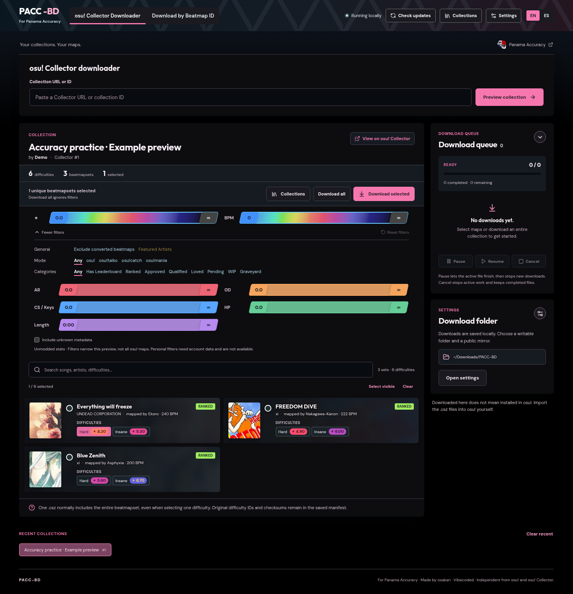

<h1 align="center">PACC-BD · Your next collection starts here</h1>

Panama Accuracy Collector &amp; Beatmap Downloader

  <a href="https://github.com/jsposu/pacc-bd/releases/latest">Download</a> ·
  <a href="docs/GUIDE.md">User guide</a> ·
  <a href="https://github.com/jsposu/pacc-bd/issues">Report an issue</a>

Preview osu! Collector collections or beatmap IDs, filter difficulties, and download `.osz` files in one place.

- **Windows:** run the `.exe` installer.
- **Linux:** make the `.AppImage` executable and run it; `libfuse2` may be required.
- **Collections:** manage osu!stable collections with backups, or export for manual import into lazer.
- **Appearance:** Dark / Light themes, English / Spanish, and desktop zoom.

**Downloads:** [Latest release](https://github.com/jsposu/pacc-bd/releases/latest) · x64 · checksums included. The Windows installer is unsigned.

Import beatmaps manually. Close osu!stable before editing collections; lazer support is export-only. The screenshot shows an example preview.

### Development

Node.js 22+ · `npm ci` · `npm run desktop`

Checks: `npm run build:all` · `npm test`

Made by **osakari** for [Panama Accuracy](https://osu.ppy.sh/teams/15959). Unofficial community app. [MIT code license](LICENSE) · [Third-party notices](THIRD_PARTY_NOTICES.md). osu! and team artwork retain their respective rights.
