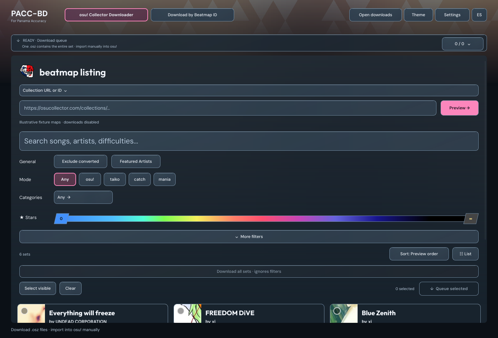

# PACC-BD

Native Rust + Slint desktop application for previewing public osu! Collector
collections or osu! beatmap IDs and downloading complete `.osz` beatmapsets.



[Download the latest release](https://github.com/jsposu/pacc-bd/releases/latest) ·
[User guide](docs/GUIDE.md) ·
[Report an issue](https://github.com/jsposu/pacc-bd/issues)

## Features

- Public osu! Collector collection previews and osu! ID/link lookup.
- Search, filters, set selection, FIFO queue and deduplicated whole-set downloads.
- Dark, Light, osu! Pink, Midnight, Forest and Sepia themes.
- Windows portable executable with state in `PACC-BD-data/rust` beside the app.
- Linux AppImage.

PACC-BD never scans or modifies `Songs`, `collection.db`, or any osu! library.
Import downloaded `.osz` files yourself. Native preferences are kept separate from
the archived Electron application and are never migrated silently.

## Development

Install the Rust toolchain, then:

```sh
cd native
cargo run
cargo test --locked
cargo clippy --locked --all-targets -- -D warnings
```

See [native/README.md](native/README.md) for diagnostics and live checks.
The [security and reliability review](docs/SECURITY-REVIEW.md) records confirmed
fixes, potential risks and checks that still require other platforms.

The former Electron implementation is preserved at
[`archive/electron-final-2026-11-20`](https://github.com/jsposu/pacc-bd/tree/archive/electron-final-2026-11-20).
Historical releases remain available on GitHub.

MIT application code. The interface uses
[Slint](https://slint.dev/) under the Slint Royalty-free Desktop, Mobile, and Web
Applications License 2.0; attribution is available from Settings through the
`AboutSlint` widget. See [third-party notices](THIRD_PARTY_NOTICES.md).
